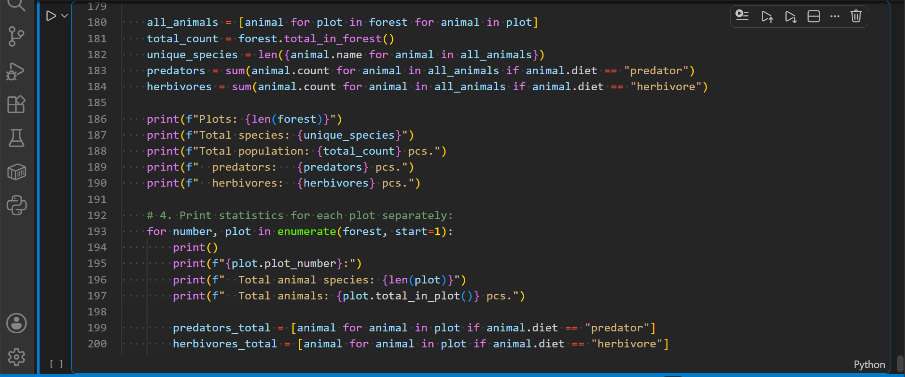
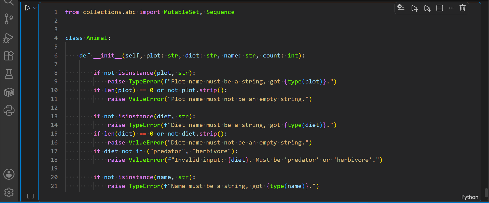
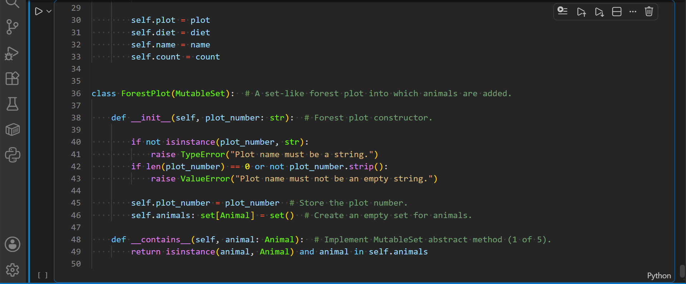
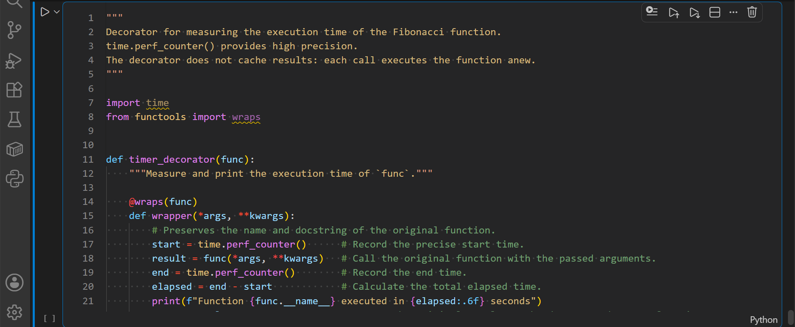
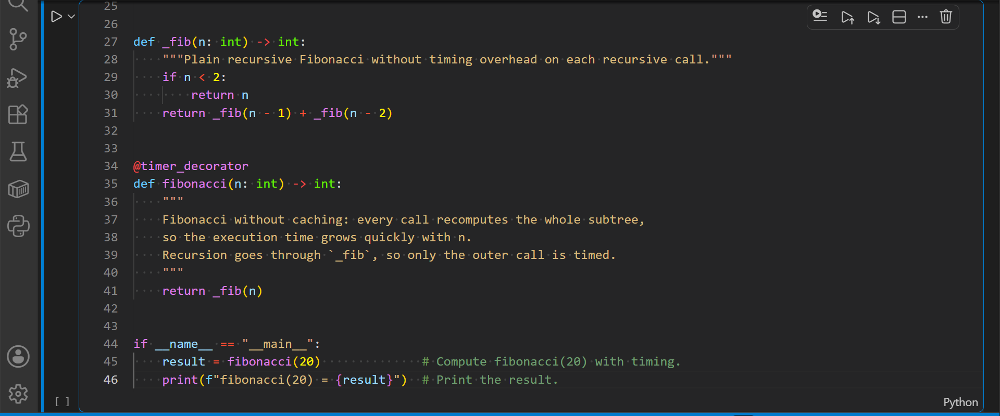
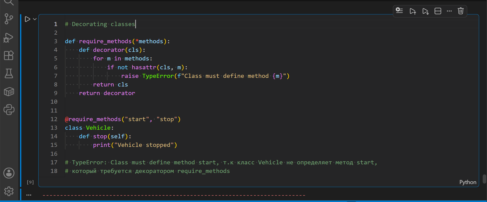

# Pion

---

## English

In the twilight, the peony unfolds:
its petals hold the glow of dawn, while the shadow holds the silence of the night.
The peony garden falls still. The moonlight touches the petals.

The old master rolled up his silk scroll and whispered:
"Do not chase the bright flame. Seek the light that lives in the half-shade."

The scroll of the old master:
muted rose-violet shades, like peony petals in moonlight, do not distract the eye but guide it along the lines, revealing the essence.

In this palette — the breath of the peony, the emerald of a blooming garden, and moonlight.
Clarity and Nobility, Elegance and Beauty.

Here every symbol is clear.
Here every line is a deep thought.
May the lines of code become poetry.

---

A dark color theme for Visual Studio Code. Based on Dark+ with a custom color scheme.

## Installation

1. Open Extensions in VS Code (`Ctrl+Shift+X`).
2. Search for **Pion**.
3. Click Install, then select the theme using `Ctrl+K Ctrl+T`.

## Preview

---

## 中文

暮色之中，牡丹徐徐绽放：
花瓣盛着黎明的微光，暗影藏着长夜的静谧。
牡丹园归于沉寂，月光轻抚花瓣。

老先生收起绢卷，轻声低语：
“莫追炫目之焰，当寻半影之中那一线生光。”

老先生的绢卷上写道：
淡雅的玫瑰紫色调，宛如月光下的牡丹花瓣，
不夺人眼目，却引视线沿行而行，见其本质。

这一方配色之中，有牡丹的呼吸、盛放园林的翠色与月光。
清明与高贵，优雅与美好。

此处，每个字符都清晰可辨。
此处，每一行都是深沉的思绪。
愿代码之行，化作诗篇。

---

适用于 Visual Studio Code 的深色配色主题。基于 Dark+ 并采用自定义配色方案。

## 安装

1. 在 VS Code 中打开扩展面板（`Ctrl+Shift+X`）。
2. 搜索 **Pion**。
3. 点击安装，然后使用 `Ctrl+K Ctrl+T` 选择主题。

## 预览

---

Publisher / 发布者: `aleksandr71914-cell`
